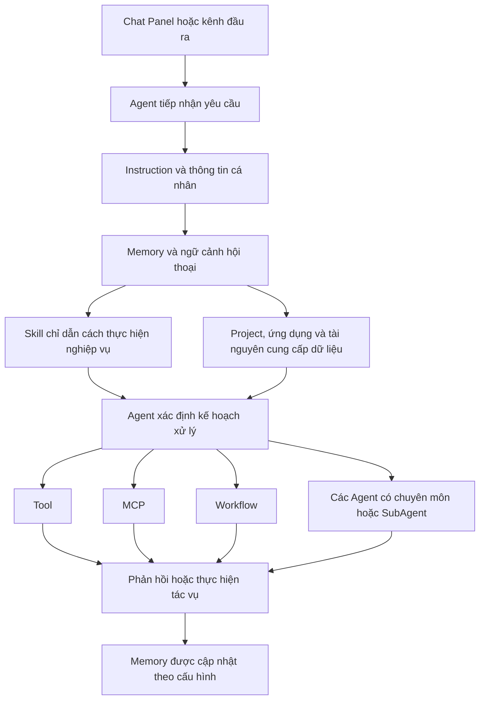

## Phân biệt các Agent trên RedAI

| Loại Agent | Đặc điểm |
| --- | --- |
| **Agent Orchestrator (RedAI - Agent Default)** | Agent mặc định của hệ thống, có tên hiển thị là **RedAI** trong Chat Panel. Agent này không phải Agent do người dùng tạo. Người dùng không thể chỉnh sửa Instruction hệ thống, kênh giao tiếp hoặc cấu hình lõi của Agent Orchestrator. Riêng Provider, API Key và Model dùng để định tuyến cho Agent này có thể được cấu hình tại **Cài đặt → Cấu hình Agent tổng** theo Workspace và Base hiện tại. |
| **Agent do người dùng tạo** | Agent được tạo và quản lý trong module AI Agent. Người dùng có thể cấu hình Model, Instruction, Memory, Skill, dữ liệu, ứng dụng, kênh giao tiếp và các năng lực khác theo nhu cầu. |

Người dùng có thể bắt đầu tạo Agent theo ba cách:

- Thiết lập thủ công trong module AI Agent.
- Gửi yêu cầu cho **Agent Orchestrator (RedAI - Agent Default)** trong Chat Panel để Agent này tạo Agent theo nhu cầu.
- Tham khảo và nhận tài nguyên **AI Agent** từ RedHub, sau đó tạo hoặc cấu hình Agent từ mẫu đã nhận.

Khi cần tối ưu một Agent đã có, người dùng có thể yêu cầu **Agent Orchestrator (RedAI - Agent Default)** hỗ trợ tối ưu hoặc yêu cầu chính Agent đó tự đánh giá và tối ưu cấu hình của mình.

## Phạm vi dữ liệu

Agent do người dùng tạo thuộc **Base đang chọn**:

- Khi chuyển Base, danh sách Agent thay đổi theo Base tương ứng.
- Agent chỉ sử dụng Skill, Project, tài nguyên, ứng dụng và cấu hình thuộc Base của Agent.
- Dữ liệu hoặc cấu hình thuộc Base khác không tự động xuất hiện trong Agent hiện tại.

## Các thành phần chính của một Agent

| Thành phần | Vai trò |
| --- | --- |
| **Provider, API Key và Model** | Xác định nhà cung cấp LLM, thông tin xác thực và Model đóng vai trò bộ não xử lý của Agent. |
| **Thinking** | Bật hoặc tắt chế độ Thinking của Model tại từng cấu hình trong danh sách ưu tiên. Trên giao diện, công tắc này có tooltip **Hiển thị thinking**. |
| **Danh sách ưu tiên và xoay key** | Cho phép cấu hình đồng thời nhiều API Key, Provider và Model, đồng thời xác định thứ tự chuyển đổi dự phòng khi vận hành. |
| **Instruction** | Quy định vai trò, mục tiêu, nguyên tắc, phạm vi và cách Agent xử lý công việc. |
| **Thông tin cá nhân** | Xác lập thông tin nhận diện, ngôn ngữ, chức vụ, kỹ năng và tính cách của Agent. |
| **Memory** | Kết hợp trí nhớ dài hạn, ngữ cảnh hội thoại và trạng thái tác vụ để Agent hiểu đúng người, đúng ngữ cảnh và đúng mục tiêu. |
| **Tài nguyên** | Cấp cho Agent các Project và dữ liệu cần truy xuất. |
| **Skills** | Lớp năng lực được gắn vào Agent, biến Agent từ một trợ lý hội thoại thành nhân sự số có khả năng thực thi nghiệp vụ thực tế. Skill chỉ dẫn Agent cách sử dụng Docs, Tools, MCPs và Workflows theo đúng mục tiêu và quy trình. |
| **Ứng dụng** | Liên kết Agent với các ứng dụng đã kết nối trong Base. |
| **Kênh** | Cấu hình tài khoản, kênh đầu ra và các cuộc hội thoại mà Agent được phép trả lời. |
| **Thông báo Agent** | Gửi tín hiệu tới cuộc trò chuyện được chọn khi Agent nhận diện đúng điều kiện mô tả. |
| **Định nghĩa chuyển đổi** | Cho phép ghim mục tiêu (goal) cụ thể cho Agent. Trong quá trình tương tác, Agent điều chỉnh cách đặt câu hỏi, phản hồi và thu thập thông tin để bám sát mục tiêu đã đặt ra. |
| **Chiến lược** | Gắn Agent xử lý trước và Agent xử lý sau Agent chính. |
| **SubAgent và Swarm** | Cho phép Agent chính phân chia công việc cho nhiều Agent có chuyên môn hoặc các Agent con chạy song song. |
| **Chiến lược Flow** | Thiết kế luồng xử lý nhiều bước, có điều kiện kích hoạt và mô tả Input/Output. |
| **Social Group** | Thiết lập cách Agent phản hồi trong nhóm bằng công tắc **Tag**. Khi bật **Seeding**, người dùng có thể cấu hình thời gian phản hồi và khoảng thời gian hoạt động, gồm múi giờ, thời gian bắt đầu–kết thúc và khung giờ riêng cho từng ngày. |
| **Vận chuyển và Thanh toán** | Bổ sung cấu hình phục vụ các nghiệp vụ thương mại. |
| **Tạo ảnh AI, Tạo video AI và Tạo giọng nói AI** | Cấp cho Agent năng lực tạo nội dung đa phương tiện theo cấu hình riêng. |

## Cách Agent xử lý yêu cầu

Agent kết hợp nhiều lớp cấu hình khi xử lý yêu cầu:

- **Instruction** định hướng vai trò, hành vi và giới hạn.
- **Memory** cung cấp thông tin đã ghi nhớ, ngữ cảnh hội thoại và trạng thái công việc.
- **Skill** cung cấp lớp năng lực và chỉ dẫn cách thực hiện đúng nghiệp vụ.
- **Project, tài nguyên và ứng dụng** cung cấp dữ liệu hoặc kết nối cần thiết.
- **Tool, MCP, Workflow và các Agent có chuyên môn** đảm nhiệm phần thực thi.

## Danh sách ưu tiên và cơ chế xoay key

Tính năng xoay key cho phép Agent tích hợp đồng thời:

- Nhiều API Key của cùng một Provider.
- Nhiều Model của cùng một Provider.
- Nhiều Provider khác nhau.

Các cấu hình Provider, API Key và Model được sắp xếp theo thứ tự trong **Danh sách ưu tiên**. Khi Provider hoặc API Key đang sử dụng gặp sự cố, bị gián đoạn hoặc bị giới hạn tần suất truy cập (rate limit), Agent tự động chuyển sang cấu hình dự phòng tiếp theo.

LLM đóng vai trò bộ não xử lý của Agent. Vì vậy, cơ chế xoay key giúp duy trì hoạt động liên tục và hạn chế việc Agent bị dừng giữa chừng khi một nguồn cung cấp gặp vấn đề.

## Kiến trúc Memory đa tầng

Kiến trúc Memory của RedAI gồm nhiều thành phần độc lập, mỗi thành phần phục vụ một mục đích khác nhau:

| Thành phần Memory | Vai trò | Đối tượng hoặc phạm vi ghi nhớ |
| --- | --- | --- |
| **Long-term Memory — Trí nhớ dài hạn** | Ghi nhớ thông tin bền vững, lâu dài. | Owner (chủ sở hữu), Agent (chính mình) và End-user (khách hàng). |
| **Short-term Memory — Trí nhớ ngắn hạn** | Giữ mạch ngữ cảnh trong từng phiên làm việc. | Thread, Session hoặc Conversation. |
| **Working Memory — Trí nhớ đang hoạt động** | Theo dõi trạng thái hiện tại, mục tiêu và bước tiếp theo của công việc đang thực hiện. | Active task state. |

Khi tương tác, Agent kết hợp đồng thời các thành phần Memory:

- **Long-term Memory — Owner:** ghi nhớ tính cách, nguyên tắc làm việc và phong cách giao tiếp của chủ sở hữu.
- **Long-term Memory — Agent:** ghi nhớ kinh nghiệm hoạt động của chính Agent để cải thiện cách xử lý ở những lần sau.
- **Long-term Memory — End-user:** ghi nhớ từng khách hàng, lịch sử quan tâm và thông tin đã trao đổi để cá nhân hóa phản hồi.
- **Short-term Memory:** duy trì mạch hội thoại hiện tại để không phải hỏi lại những thông tin vừa được cung cấp.
- **Working Memory:** theo dõi mục tiêu, trạng thái và bước tiếp theo của tác vụ đang chạy.

Nhờ kết hợp nhiều lớp Memory, Agent có thể phản hồi theo đúng người dùng, đúng ngữ cảnh và đúng mục tiêu công việc.

## Memory Agent và Graph RAG

**Memory Agent** là cơ chế lưu giữ và truy xuất Long-term Memory của Agent dưới dạng **Graph RAG**. Memory Agent nằm trong lớp Long-term Memory của kiến trúc Memory đa tầng, không phải một loại Memory độc lập ngang hàng với Long-term Memory, Short-term Memory và Working Memory.

Kiến thức dài hạn được:

1. Trích xuất thành các node độc lập.
2. Liên kết qua các quan hệ (edge).
3. Tổ chức thành đồ thị có cấu trúc.
4. Truy xuất theo những node liên quan đến yêu cầu hiện tại.

Agent không cần nạp toàn bộ trí nhớ trong mỗi lần xử lý. Cách truy xuất theo node liên quan giúp giảm lượng token cần sử dụng trong khi vẫn khai thác được nhiều thông tin. Mỗi đơn vị Memory còn được phân loại theo loại Memory, mức độ hữu ích và số lượng liên kết để Agent ưu tiên thông tin quan trọng và kiểm soát quy mô đồ thị.

Memory được tách theo từng Agent. Trong mỗi Agent, thông tin của End-user tiếp tục được phân biệt theo từng người dùng hội thoại.

### Bảo trì Memory nền

Khi bật **Bảo trì nền**, một Agent nền (background agent) chạy ngầm để trích xuất và cấu trúc hóa Memory theo luồng:

`Trích xuất → Graph → RAG → Graph RAG`

Agent nền mặc định được nhân bản từ Agent chính. Hệ thống kích hoạt Agent nền sau số lượt hoạt động được cấu hình tại **Chạy mỗi N lượt**. Quá trình này diễn ra ngầm và không làm gián đoạn luồng phục vụ người dùng của Agent chính.

## SubAgent và cơ chế Swarm

RedAI hỗ trợ tối đa **8 SubAgent chạy song song** theo cơ chế Swarm. Agent chính có thể phối hợp với nhiều Agent có chuyên môn, Skill và Tool riêng để xử lý các phần việc khác nhau trong cùng nhiệm vụ.

SubAgent có thể được nhân bản từ cấu hình Agent chính. Người dùng cũng có thể bổ sung các Agent có chuyên môn vào danh sách SubAgent để Agent chính phân công đúng phần việc.

Trường **Số nhiệm vụ agent con tối đa mỗi thread** giới hạn số tác vụ `agent_subtask` đang hoạt động trong một thread. Tác vụ đã hoàn thành hoặc thất bại không tiếp tục chiếm slot.

## Thực thi qua kênh đầu ra

Agent do người dùng tạo có thể thực hiện tác vụ qua kênh đầu ra tương tự khi làm việc trong Chat Panel nếu đáp ứng đồng thời các điều kiện sau:

1. Agent được gắn đúng **Skill hệ thống** cung cấp năng lực tương ứng.
2. Trong **Cấu hình Agent → Kênh**, chọn đúng kênh đầu ra.
3. Tại **Quyền AI theo hội thoại**, chuyển vai trò của người dùng trong cuộc hội thoại từ **Khách hàng** sang **Chủ sở hữu**.
4. Bảo đảm quyền cho phép AI trả lời của cuộc hội thoại vẫn được bật.

Vai trò **Chủ sở hữu** được gán cho người dùng trong cuộc hội thoại, không phải cho Agent. Phạm vi thực thi của Agent vẫn phụ thuộc vào Skill, tài nguyên và quyền đã được cấu hình.

## Trạng thái Agent

- Agent đang bật có thể được chọn trong Chat Panel và hoạt động trên các kênh đã cấu hình.
- Khi tắt Agent, Agent ngừng hoạt động ở cả Chat Panel và các kênh đầu ra.
- Xóa Agent là xóa vĩnh viễn và không thể khôi phục.

> **Cảnh báo:** Hệ thống hiển thị hộp xác nhận trước khi xóa. Chỉ xác nhận khi chắc chắn không còn cần Agent.
