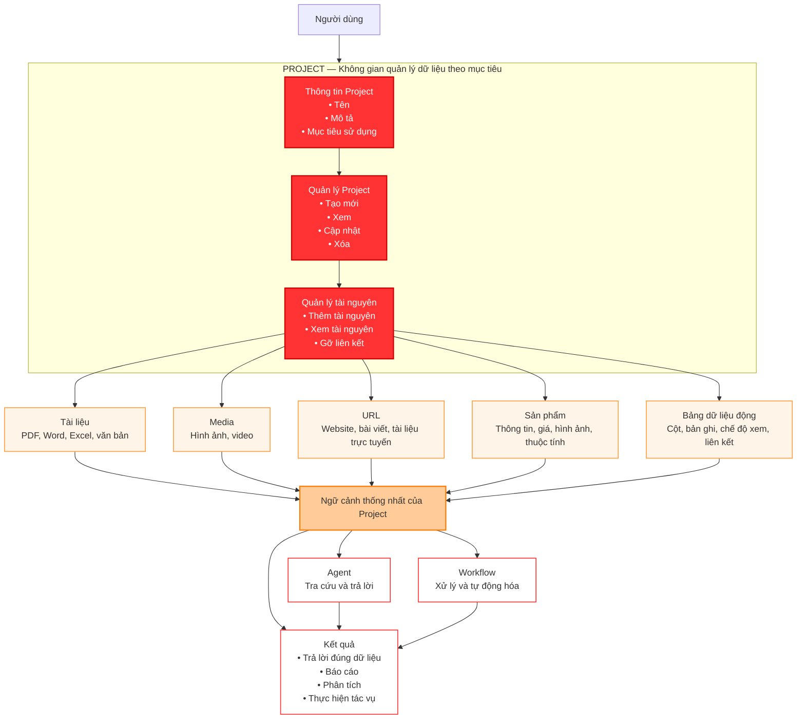

## Mở khu vực quản lý Project

| Bước | Cách thực hiện |
| --- | --- |
| 1 | Mở **AI Drive** trên RedAI. |
| 2 | Chọn tab **Projects** trên thanh điều hướng phía trên. Danh sách Project hiện có xuất hiện. |

## 1. Các thành phần chính

| Thành phần | Nội dung trong Project | Khả năng chính |
| --- | --- | --- |
| **Media** | Hình ảnh và video | Cung cấp thông tin trực quan về sản phẩm, thương hiệu, không gian hoặc quy trình |
| **Files** | Tài liệu, chính sách, hướng dẫn, báo cáo và bảng thông tin | Cung cấp nội dung tài liệu để Agent tra cứu và phân tích |
| **URLs** | Trang giới thiệu, hướng dẫn, chính sách, FAQ và các trang web liên quan | Đưa nội dung từ website vào phạm vi của Project |
| **Product** | Sản phẩm được liên kết với Project | Bổ sung dữ liệu sản phẩm thuộc đúng bối cảnh sử dụng |
| **Bảng** | Bảng dữ liệu được liên kết với Project | Cho phép cấu hình riêng quyền xem, thêm, sửa, xóa, xuất, chia sẻ, quyền theo cột và điều kiện lọc hàng cho Agent |

Project chỉ tổ chức phạm vi sử dụng; tài nguyên vẫn được quản lý tại các khu vực tương ứng trong AI Drive.

## 2. Các nhóm tính năng chính

| Nhóm tính năng | Khả năng |
| --- | --- |
| Tạo Project | Đặt tên và mô tả để xác định mục đích, phạm vi dữ liệu |
| Thêm tài nguyên | Chọn Media, Files, URLs, Product hoặc Bảng đã có; tạo tài nguyên mới nếu cần |
| Quản lý theo loại | Chuyển giữa các tab tài nguyên, xem chi tiết và cập nhật thông tin được hỗ trợ |
| Xử lý hàng loạt | Chọn nhiều tài nguyên để thêm vào Project hoặc xóa theo chức năng trên từng màn hình |
| Kiểm soát Bảng | Cấu hình quyền Agent riêng cho từng Bảng trong Project |

## 3. Cách hoạt động

