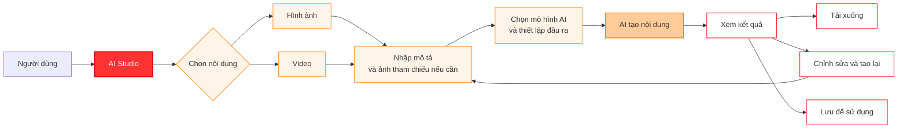

## 1. Các thành phần chính

| Thành phần | Chức năng |
| --- | --- |
| **Tạo ảnh** | Tạo ảnh từ văn bản hoặc ảnh tham chiếu khi model hỗ trợ. |
| **Tạo video** | Tạo video từ văn bản hoặc ảnh đầu vào; một số model hỗ trợ ảnh bắt đầu và ảnh kết thúc. |
| **Mô tả / Prompt** | Xác định chủ thể, bối cảnh, bố cục, phong cách và yêu cầu đầu ra. |
| **Mô hình** | Cung cấp khả năng và các thiết lập tương ứng cho ảnh hoặc video. |
| **Thiết lập đầu ra** | Cấu hình kích thước, tỷ lệ, chất lượng, số lượng hoặc thời lượng theo model đang chọn. |
| **Ảnh tham chiếu** | Làm nguồn đầu vào cho chế độ tạo từ ảnh khi model hỗ trợ. |
| **Thư viện kết quả** | Hiển thị nội dung đã tạo, biến thể và trạng thái xử lý. |
| **Tích hợp** | Kết nối nhà cung cấp model bằng OAuth hoặc API key. |

## 2. Các nhóm tính năng chính

| Nhóm tính năng | Khả năng |
| --- | --- |
| Tạo ảnh | Chọn chế độ văn bản sang ảnh hoặc ảnh sang ảnh; cấu hình model và đầu ra. |
| Tạo video | Chọn chế độ văn bản sang video hoặc ảnh sang video; cấu hình thời lượng, tỷ lệ và số lượng. |
| Theo dõi kết quả | Xem nội dung hoàn tất, nội dung **Đang tạo** và các biến thể trong thư viện. |
| Điều chỉnh đầu ra | Cập nhật mô tả, ảnh tham chiếu, model hoặc thiết lập rồi tạo lại. |
| Tích hợp model | Kết nối nhà cung cấp qua OAuth hoặc API key và kiểm tra model khả dụng. |
| Theo dõi mức sử dụng | Kiểm tra tài nguyên sử dụng trước hoặc sau các yêu cầu tạo nội dung. |

## 3. Luồng hoạt động của người dùng

Ảnh có thể được trả về ngay hoặc xử lý theo tác vụ. Video thường cần thời gian xử lý lâu hơn. Kết quả chỉ sẵn sàng sử dụng sau khi trạng thái xử lý hoàn tất.

## 4. Nguyên tắc cần biết

- Chọn **Tạo ảnh** hoặc **Tạo video** trước khi chọn model; model ảnh và model video thuộc hai luồng riêng.
- Các chế độ tạo, kích thước, tỷ lệ, chất lượng, số lượng, thời lượng và ảnh đầu vào phụ thuộc vào model. Chỉ dùng tùy chọn đang hiển thị.
- Khi đổi model, kiểm tra lại toàn bộ thiết lập vì một số giá trị có thể thay đổi hoặc được đặt lại.
- Trạng thái **Đang tạo** nghĩa là nội dung chưa sẵn sàng để sử dụng hoặc chia sẻ.
- Video thường xử lý lâu hơn ảnh. Chất lượng cao hoặc nhiều đầu ra có thể làm tăng mức sử dụng tài nguyên.
- Chỉ dùng ảnh tham chiếu mà bạn có quyền sử dụng; không đưa dữ liệu nhạy cảm vào prompt hoặc ảnh đầu vào.
- API key và token OAuth là thông tin nhạy cảm. Không đưa chúng vào prompt, tài liệu công khai, ảnh chụp màn hình hoặc tên kết nối.
- Danh sách model phụ thuộc vào nhà cung cấp, quyền tài khoản, phương thức kết nối và cấu hình Workspace.
