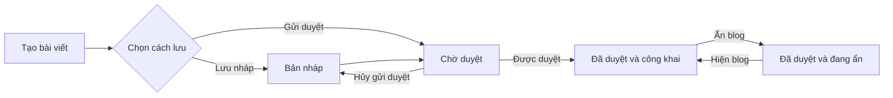

## Community Hub dùng để làm gì?

Community Hub hỗ trợ hai luồng chính:

| Luồng | Khả năng |
|---|---|
| **Khám phá nội dung** | Tìm kiếm, xem thông tin tóm tắt và mở bài viết công khai để đọc. |
| **Đăng và quản lý bài viết** | Soạn nội dung, lưu nháp, gửi duyệt, theo dõi trạng thái và điều chỉnh việc hiển thị bài đã duyệt. |

## Các khu vực chính

| Khu vực | Chức năng |
|---|---|
| **Community Hub** | Hiển thị các bài viết công khai dưới dạng thẻ. |
| **Chi tiết bài viết** | Hiển thị ảnh đại diện, tiêu đề, lượt xem, mô tả, tác giả, thẻ, nội dung và khu vực bình luận. |
| **Tạo bài viết** | Soạn nội dung, tải ảnh đại diện, thêm thẻ, lưu nháp hoặc gửi duyệt. |
| **Blog của tôi** | Quản lý các bài do người dùng tạo và thao tác theo trạng thái của từng bài. |

## Cách hoạt động

## Trạng thái bài viết

| Trạng thái | Ý nghĩa |
|---|---|
| **Bản nháp** | Bài được lưu riêng để tiếp tục chỉnh sửa và chưa nằm trong quy trình xét duyệt. |
| **Chờ duyệt** | Bài đã được gửi vào quy trình xét duyệt. |
| **Đã duyệt** | Bài đã được phê duyệt và có thể hiển thị công khai. |
| **Đang ẩn** | Bài đã duyệt nhưng đang được tác giả ẩn khỏi Community Hub. |
