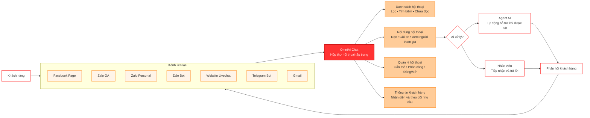

## 1. Các kênh hội thoại

| Nền tảng | Loại kênh trong OmniAI Chat |
| --- | --- |
| **Facebook** | **Facebook Page** — tin nhắn gửi đến Trang Facebook đã kết nối. |
| **Zalo** | **Zalo OA** — hội thoại từ Zalo Official Account. |
| **Zalo** | **Zalo Personal** — hội thoại từ tài khoản Zalo cá nhân. |
| **Zalo** | **Zalo Bot** — tin nhắn được tiếp nhận qua Bot trên Zalo. |
| **Telegram** | **Telegram Bot** — tin nhắn gửi đến Bot Telegram. |
| **Google** | **Gmail** — email gửi đến tài khoản Gmail đã kết nối. |
| **Website** | **Website Livechat** — hội thoại từ Livechat được tích hợp trên website. |

Danh sách hội thoại thực tế phụ thuộc vào tài khoản và Output Channel đã được cấu hình trong Workspace.

## 2. Các thành phần chính

| Thành phần | Chức năng |
| --- | --- |
| **Tài khoản** | Xác định Facebook Page, Zalo OA/Personal/Bot, Telegram Bot, Gmail hoặc Website Livechat đang được quản lý. |
| **Danh sách hội thoại** | Hiển thị các liên hệ và hỗ trợ tìm kiếm, lọc theo từ khóa, nhãn hoặc người đảm nhiệm. |
| **Nội dung hội thoại** | Hiển thị lịch sử tin nhắn và khu vực gửi văn bản, tệp, ảnh, Sticker hoặc giọng nói. |
| **AI Chat** | Cho phép AI Agent tự động phản hồi hội thoại khi được bật. |
| **Thông tin hội thoại** | Quản lý người hỗ trợ, nhãn, trạng thái AI Chat và thao tác xóa hội thoại. |
| **Công cụ hội thoại** | Tóm tắt bằng AI, tạo dữ liệu fine-tuning và tạo đơn hàng từ nội dung trao đổi. |

## 3. Các nhóm tính năng chính

| Nhóm tính năng | Khả năng |
| --- | --- |
| Chọn và tìm hội thoại | Đổi tài khoản, mở liên hệ, tìm kiếm, lọc và làm mới danh sách. |
| Gửi nội dung | Gửi tin nhắn, tệp đính kèm, ảnh từ thư viện, Sticker hoặc nội dung giọng nói. |
| Phối hợp AI và nhân viên | Bật AI Chat để Agent phản hồi tự động; tắt AI Chat để nhân viên tiếp quản. |
| Phân loại và phân công | Gắn nhãn và chọn người hỗ trợ cho từng hội thoại. |
| Khai thác hội thoại | Tóm tắt bằng AI, chọn tin nhắn để tạo dữ liệu fine-tuning hoặc tạo đơn hàng. |
| Điều chỉnh giao diện | Dùng chế độ toàn màn hình, hiển thị người đảm nhiệm, hiển thị tag và cấu hình memory. |

## 4. Luồng hoạt động của người dùng

Tin nhắn được phản hồi bằng chính tài khoản kênh đang chọn. Khi AI Chat bật, Agent có thể tự động gửi phản hồi; khi AI Chat tắt, nhân viên xử lý thủ công.

## 5. Nguyên tắc cần biết

- Kiểm tra đúng tài khoản và đúng liên hệ trước khi gửi nội dung.
- Chỉ bật **AI Chat** sau khi đã kiểm tra Agent, dữ liệu và phạm vi xử lý; hệ thống có thể tự động gửi phản hồi cho khách hàng.
- Theo dõi nhãn Agent trên tin nhắn để nhận biết nội dung do AI gửi.
- Gắn nhãn và người hỗ trợ theo quy ước chung để hội thoại dễ lọc và bàn giao.
- Kiểm tra tin nhắn gốc trước khi sử dụng bản tóm tắt do AI tạo.
- Không đưa dữ liệu cá nhân, thông tin nhạy cảm hoặc nội dung chưa được phép sử dụng vào dữ liệu fine-tuning.
- Kiểm tra đúng liên hệ và lưu thông tin cần thiết trước khi xóa hội thoại.
