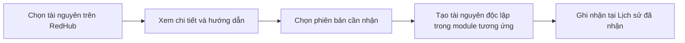
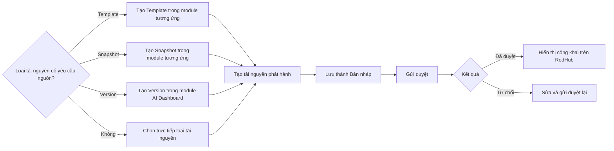

## RedHub dùng để làm gì?

RedHub hỗ trợ hai luồng chính:

| Luồng | Giá trị |
|---|---|
| **Khám phá và nhận tài nguyên** | Tìm mẫu phù hợp, xem hướng dẫn, nhận một hoặc nhiều phiên bản và cấu hình lại theo nhu cầu. |
| **Phát hành tài nguyên** | Chuẩn bị Template, Snapshot hoặc Version nếu loại tài nguyên yêu cầu, tạo tài nguyên phát hành, quản lý phiên bản và gửi duyệt. |

RedHub phù hợp khi người dùng muốn:

- Triển khai nhanh Agent, Workflow hoặc tài nguyên nghiệp vụ có sẵn.
- Tham khảo cấu hình và hướng dẫn từ người phát hành.
- Lưu lại tài nguyên đã nhận để có thể tạo lại khi bản trong module bị xóa.
- Chia sẻ tài nguyên do mình xây dựng cho cộng đồng người dùng RedAI.

## Các loại tài nguyên

RedHub hỗ trợ 11 loại:

1. AI Agent.
2. Workflow.
3. Knowledge File.
4. Tool.
5. Skill.
6. Prompt.
7. Email Template.
8. Integration.
9. Dynamic Table.
10. Combo.
11. AI Dashboard.

## Ba khu vực chính

| Khu vực | Chức năng |
|---|---|
| **RedHub** | Khám phá, tìm kiếm, lọc, xem chi tiết và nhận tài nguyên công khai. |
| **Lịch sử đã nhận** | Xem lại và tạo thêm bản sao từ các tài nguyên đã nhận trong Base hiện tại. |
| **Tài nguyên phát hành** | Tạo, gửi duyệt và quản lý tài nguyên do người dùng phát hành trong Base hiện tại. |

## Phạm vi Base và quyền truy cập

- Tài nguyên được nhận vào Base đang chọn.
- Danh sách **Lịch sử đã nhận** và **Tài nguyên phát hành** thay đổi theo Base.
- Template, Snapshot hoặc Version dùng làm nguồn phát hành phải thuộc Base hiện tại.
- Mọi thành viên có quyền truy cập Base đều có thể nhận tài nguyên.
- Khả năng tạo và phát hành tài nguyên phụ thuộc vào quyền được cấp trong role.

## Cách nhận tài nguyên

Mỗi phiên bản được nhận sẽ tạo một tài nguyên độc lập trong module tương ứng. Nếu nhận nhiều phiên bản, hệ thống tạo nhiều tài nguyên riêng biệt.

Khi nhận lại một phiên bản đã nhận, hệ thống hỏi **Tạo bản sao mới?**. Nếu xác nhận, một bản sao độc lập mới được tạo từ đúng phiên bản đó.

## Cách phát hành tài nguyên

- **AI Agent** và **Workflow** dùng Template được tạo tại module tương ứng.
- **Skill** và **Dynamic Table** dùng Snapshot được tạo tại module tương ứng.
- **AI Dashboard** dùng Version được tạo trong module AI Dashboard.
- **Knowledge File**, **Tool**, **Prompt**, **Email Template**, **Integration** và **Combo** không cần chuẩn bị dữ liệu nguồn; người dùng chọn trực tiếp loại tài nguyên khi tạo bản phát hành.
- Phiên bản đầu tiên luôn là **v1**.
- Tài nguyên chỉ hiển thị công khai sau khi được duyệt.
- Sau khi được duyệt, bản phát hành hoạt động độc lập với Template, Snapshot hoặc Version đã dùng làm nguồn.

## Các khái niệm cần phân biệt

| Khái niệm | Ý nghĩa |
|---|---|
| **Tài nguyên nguồn** | Tài nguyên đang tồn tại trong module của Base. |
| **Template** | Dữ liệu nguồn dùng để phát hành AI Agent hoặc Workflow. |
| **Snapshot** | Dữ liệu nguồn dùng để phát hành Skill hoặc Dynamic Table. |
| **Version** | Dữ liệu nguồn dùng để phát hành AI Dashboard. |
| **Tài nguyên phát hành** | Bản ghi được tạo trong RedHub, có phiên bản và trạng thái xét duyệt. |
| **Tài nguyên đã nhận** | Bản độc lập được tạo trong module tương ứng sau khi nhận. |
| **Lịch sử đã nhận** | Nơi lưu bản ghi để xem lại hoặc tạo thêm bản sao từ tài nguyên đã nhận. |
