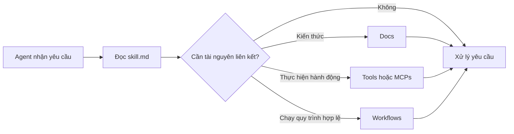

## Hai loại Skill

| Loại Skill | Phạm vi và cách sử dụng |
| --- | --- |
| **Skill hệ thống** | Do hệ thống cung cấp, giống nhau ở mọi tài khoản, Workspace và Base. Có thể sử dụng trực tiếp nhưng không thể sửa. Muốn tùy chỉnh, cần nhân bản thành Skill User. |
| **Skill User** | Do người dùng tạo hoặc nhân bản, thuộc Workspace và Base đang chọn. Danh sách thay đổi khi chuyển Workspace hoặc Base. |

Skill hệ thống và Skill User đều có thể được nhân bản. Bản nhân bản luôn là một Skill User mới; người dùng có thể chọn sao chép kèm Docs, Tools, MCPs và Workflows.

## Thành phần của một Skill

| Thành phần | Chức năng |
| --- | --- |
| **Tên Skill** | Xác định nghiệp vụ hoặc khả năng của Skill. |
| **Mô tả** | Tóm tắt mục đích và phạm vi sử dụng. |
| **Phân loại (nếu có)** | Trường không bắt buộc, dùng để nhóm và lọc Skill theo chủ đề. |
| **Logo (nếu có)** | Hình ảnh nhận diện Skill. |
| **Nội dung Skill (`skill.md`)** | Tệp quan trọng nhất, chứa chỉ dẫn để Agent hiểu mục tiêu, quy trình, quy tắc và cách sử dụng Skill. |
| **Docs** | Tài liệu bổ trợ có thể được thêm, sửa hoặc xóa trong Skill. |
| **Tools** | Công cụ được liên kết để Agent thực hiện hành động. |
| **MCPs** | Kết nối MCP được liên kết với Skill. |
| **Workflows** | Quy trình được liên kết với Skill. Agent chỉ có thể kích hoạt qua Skill khi node đầu tiên là **Kích hoạt Click**, **Kích hoạt Hệ thống Tùy chỉnh** hoặc **Kích hoạt Tin nhắn**. |

`skill.md` quyết định cách Agent hiểu và sử dụng Skill; các tài nguyên liên kết chỉ bổ trợ cho chỉ dẫn này. Việc liên kết một Workflow không đồng nghĩa Agent có thể kích hoạt Workflow đó nếu node đầu tiên không thuộc ba loại đã nêu.

## Cách Skill hoạt động

## Các nhóm tính năng chính

| Nhóm tính năng | Khả năng |
| --- | --- |
| Khám phá thư viện | Chuyển giữa **User** và **Hệ thống**; tìm kiếm và lọc theo phân loại. |
| Tạo và cập nhật | Tạo thường, tạo bằng AI, cập nhật trực tiếp hoặc cập nhật bằng AI. |
| Tạo qua Agent | Yêu cầu **Agent Orchestrator (RedAI - Agent Default)** hoặc Agent do người dùng tạo có gắn Skill `RedAI - Module - Skill` tạo Skill. |
| Quản lý tài nguyên | Thêm, sửa hoặc xóa Docs; liên kết hoặc xóa liên kết Tools, MCPs và Workflows. |
| Tái sử dụng | Nhân bản Skill, tạo hoặc nhập Snapshot, Import hoặc Export gói Skill. |
| RedHub | Dùng Snapshot làm nguồn phát hành hoặc nhận template Skill đã phát hành về Base hiện tại. |

## Phạm vi dữ liệu

- Skill hệ thống không thay đổi theo tài khoản, Workspace hoặc Base.
- Skill User, Snapshot và Skill được Import thuộc Workspace và Base đang chọn.
- Trước khi tạo, nhân bản, Import hoặc nhận Skill từ RedHub, cần chọn đúng Workspace và Base.

## Các nút chính trong module Skills

Tên trong ngoặc là tooltip hoặc nhãn hiển thị trên giao diện.

| Biểu tượng | Tên trên giao diện | Chức năng |
| --- | --- | --- |
|  | **Tạo skill mới** | Mở hai cách tạo: **Tạo thường** và **Tạo bằng AI**. |
|  | **Tìm kiếm** | Tìm Skill hoặc Snapshot theo từ khóa. |
|  | **Lọc** hoặc **Bộ lọc** | Mở các điều kiện lọc của màn hình hiện tại. |
|  | **Chọn tất cả** | Chọn toàn bộ tài nguyên trong danh sách hiện tại. |
|  | **Quản lý snapshots** | Mở danh sách Snapshot trong Base hiện tại. |
|  | **Import package** | Nhập tệp `.json` chứa gói Skill từ thiết bị. |
|  | **Tải lại dữ liệu** | Cập nhật danh sách theo dữ liệu mới nhất. |
|  | **Sửa** | Mở màn hình cập nhật Skill User. |
|  | **Nhân bản** | Tạo một Skill User mới từ Skill đang chọn. |
|  | **Xóa** hoặc **Xóa skill** | Xóa đối tượng theo ngữ cảnh hiện tại; hệ thống luôn yêu cầu xác nhận. |
|  | **Thao tác** | Mở menu thao tác của một Snapshot. |
|  | **Lưu** | Lưu hoặc xác nhận form. |
|  | **Hủy** | Hủy thao tác hoặc đóng form. |
